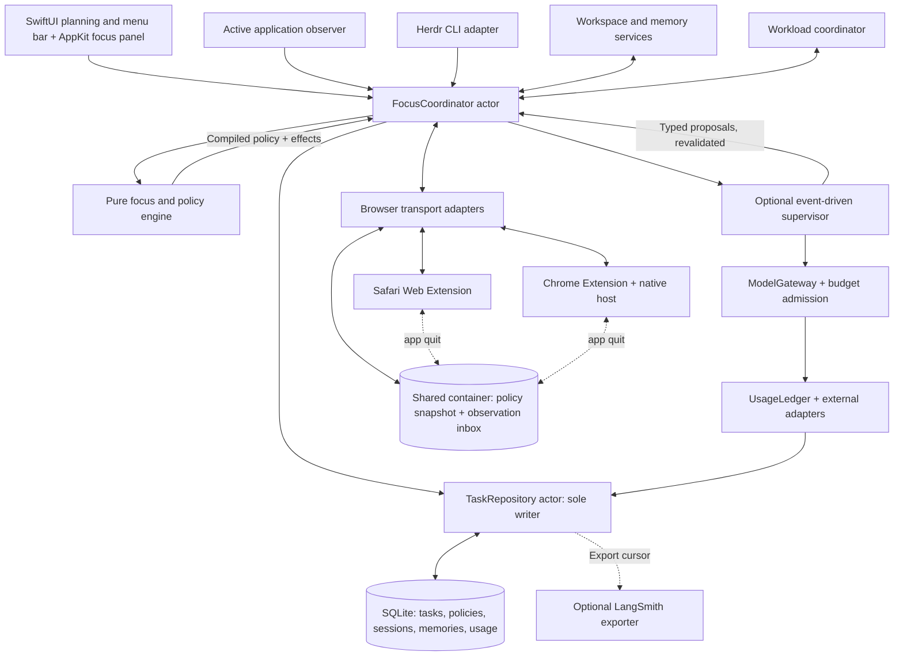

# Architecture proposal

## Core choice

Native SwiftUI app with AppKit integration, local SQLite storage through GRDB.swift (owner decision, 2026-10-13), Safari Web Extension, Chrome extension, and a Herdr adapter. Provisional distribution: Developer ID signed/notarized direct download, pending packaging validation. This reduces main-app sandbox constraints but does not remove extension sandboxes or system permissions. Supported macOS: 26 only (owner decision, 2026-10-13). Minimum browser versions remain unresolved. Until the owner joins the Apple Developer Program, builds are signed to run locally and Safari needs its unsigned-extension setting, which resets when Safari restarts.

The shared container and dotted paths are proposals pending the Safari and Chrome transport spikes ([decision 0003](decisions/0003-architecture-review-corrections.md)).

## Components

- FocusCoordinator: serialized Swift actor owning state transitions, revisions, event processing and policy delivery/acknowledgement tracking. UI observes snapshots.
- Focus engine: pure function of current state and an injected clock that returns the compiled policy and effects (session lifecycle, site policy, exception expiry, planned breaks, cooldowns, integration health). No I/O, no model dependency; expiry, sleep/wake and browser-switch cases are unit-testable.
- Supervisor: receives a bounded context on meaningful events and returns typed proposals with explanations. Recheck revisions before applying any proposal.
- TaskRepository actor: single authoritative SQLite writer for task/session/policy data and accepted-decision records; derived indexes are rebuildable. Extensions exchange snapshots/events, never write the task database directly.
- Activity observer: foreground app identity and timestamp. Browser extension reports tab context with required permissions. App identity alone cannot identify meaningful progress. During a session, an unsupported browser (or one without an acknowledging extension) becoming frontmost marks protection degraded.
- Herdr adapter: inspect installed command syntax/version, use explicit session/server identity, parse opaque IDs and statuses, and revalidate targets before actions. CLI output is untrusted text.
- Browser adapters: browser-specific transport, shared policy format and rule semantics where possible. Do not assume API parity.
- ModelGateway: all supervisor model calls pass through context/token limits, local budget admission, bounded retries and provider adapters. Proposed P0: one supervisor request in flight at a time, so admission is a simple check against the daily cap. Native Swift orchestration; no LangGraph runtime required.
- UsageLedger: persisted attempt-level accounting through the TaskRepository writer; reservations become necessary only if concurrency exceeds one. External usage adapters preserve provenance and confidence; Herdr state alone supplies no token accounting.
- LangSmith exporter: optional, sanitized asynchronous trace delivery reading ledger rows through an export cursor. Transport options: bespoke REST mapping or LangSmith's documented OTLP endpoint; evaluate both. Do not assume an official Swift SDK or require another runtime.
- Workload coordinator: maps runs to tasks and proposes deferral/interruption based on deadlines, dependencies and attention, with usage as supporting evidence when measured. No generic process-kill capability in first release.
- Workspace service: SetupPlan preview, path validation and reconciliation ([workspace rules](WORKSPACE_RULES.md)). Memory service: retrieval and deletion of derived records ([data and memory](DATA_AND_MEMORY.md)).

## Process model

Proposal: one menu-bar-resident app process (`LSUIElement`-style), registered as a login item with `SMAppService.mainApp`. The planning window and focus panel are windows of that process; closing them keeps state live. Add a separate background agent or XPC service only if a spike shows the single process is insufficient.

The Safari extension handler and the Chrome native host are separate processes and may run while the app is quit, so the in-process TaskRepository actor cannot be their writer. Cross-process contract:

1. The app publishes the current compiled policy snapshot to a shared location readable by both helpers.
2. Helpers read the snapshot and append browser observations and acknowledgements to an observation inbox; they never write authoritative tables.
3. The app imports and deduplicates the inbox (by browser/profile identity and sequence) on launch, wake and reconnect.

Whether an App Group container provides this for a Developer ID–signed app and its sandboxed Safari extension is a spike question, not an assumption.

## Enforcement ownership

Each browser extension enforces the last policy it acknowledged; the app only writes and updates that policy. Every policy carries an absolute session end and absolute exception expiries, so the extension can keep enforcing it correctly without the app. Extensions check it against their own clock on every wake (startup, worker start, alarm, message).

When the app cannot update the policy (crashed, quit, or asleep through the end time), the extension follows the session's mode (owner decision, 2026-10-13):

- Normal session: keep blocking until the planned session end, then stop on its own. An app crash never unblocks sites mid-session and never leaves them blocked indefinitely.
- Strict session: keep blocking past the planned end until the app reconnects and confirms the session ended. The blocked page states that FocusPilot is not running and how to reopen it.

Exception expiries apply in both modes; an exception never outlives its expiry because the app is unavailable.

Some rule sets are always active (owner decision, 2026-10-13); others follow a schedule or apply only during focus sessions. Always-on and scheduled rules have no session end: extensions keep enforcing them whether or not the app is running, and evaluate schedule windows against their own clock. Only session-only rules follow the normal/strict behavior above. Changing or removing an always-on rule is an explicit owner action in the app, never a model proposal applied automatically.

Blocked Mac apps (owner decision, 2026-10-14) are enforced by the app itself, not by an extension: when a blocked app is launched or activated while its rule applies, FocusPilot hides it (`NSRunningApplication.hide()`, observed through `NSWorkspace.didActivateApplicationNotification`) and shows a blocked-app panel with the current action, Return to task and a timed exception for the whole app. It never quits the app, so no unsaved work is lost. This works only while FocusPilot is running, so protection status reports browsers and apps as separate facts and never summarizes them as "protected" alone.

Documented Chrome lifecycle, to design around rather than discover:

- Service workers stop after 30 seconds idle; an open `connectNative()` port keeps the worker alive (Chrome 105+). Reconnect in `onDisconnect`.
- `chrome.alarms` fire at most every 30 seconds and may be delayed; missed alarms fire after wake. Persistence across browser restart is documented from Chrome 150 only, so also reconcile on `onStartup`.

Candidate for already loaded pages and buffered media: a content script on blocked domains holds the exception expiry and blanks or redirects the page when it passes, independent of worker suspension. On policy activation, matching open tabs are redirected. Requires host permissions; Safari behavior must be validated.

Chrome runs one extension instance and native host per profile, so acknowledgements are tracked per profile. Incognito/private windows require explicit extension permission; report their state rather than assuming coverage. Absolute expiry instants rely on the system clock; changing it is a known bypass consistent with no tamper-resistance claim.

## Browser transport feasibility

Safari packages its web extension with a containing macOS app and supports native messaging. The implementation must prove how the sandboxed extension handler exchanges state with the running app, including when the UI is closed. An App Group mailbox/shared store is a candidate, not a validated transport.

Chrome requires its own native messaging host registration or another authenticated local bridge. Prefer proving native messaging first; do not expose an unauthenticated loopback server. Treat Safari and Chrome packaging/lifecycle as different adapters.

Policy protocol: schema version, revision, session ID, session end, effective time, exception expiry, rule checksum, and acknowledgement. Browser observations carry browser/profile identity, sequence and observed-at timestamp. Reject out-of-order data. Show protected, syncing, degraded or unknown; a missing acknowledgement means protection is incomplete.

## Background and enforcement

Closing the planning window should keep the app available through the menu bar. Application exit, browser termination, extension disablement, sleep, and restart are distinct states.

Use absolute expiry instants for persisted exceptions, and monotonic elapsed time for foreground duration accounting. Reconcile on wake, browser reconnect, and launch. Extension background workers cannot be assumed continuously running. Explore browser alarms/native refresh and a conservative fallback; prove expiry and recovery in a spike.

Installed browser rules should not depend on a model being online. Blocking an already-open SPA, private browsing permission, exception expiry while native app is quit, and suspended workers need explicit validation. DNR network rules do not themselves close an already loaded page or stop buffered media. Report measured expiry overrun rather than promise exact closure. Browser extensions can be disabled; first release does not claim tamper resistance.

## iPhone distraction signal

Owner decision, 2026-10-13; every mechanism below requires the iPhone spike. Screen Time data stays on the iPhone and a companion iOS app would need the Family Controls entitlement, so phase 1 uses built-in Shortcuts and iCloud Drive instead. The iPhone blocker (Opal) is untouched.

1. Session start/end: the app runs an owner-created Shortcut through the `shortcuts` command-line tool to turn a "FocusPilot" Focus on or off ("Share across devices" carries it to the iPhone), and writes the current action and session mode to a small file in an iCloud Drive folder.
2. iPhone: personal automations on "app is opened" and "app is closed" for owner-listed apps (e.g. Prime Video, games). If the FocusPilot Focus is on, the open automation shows "Go back to: <current action>", in strict sessions also returns to the Home Screen, and appends the app name and time to a phone-events file; the close automation appends the close time.
3. Mac: the app imports new phone events as observations, notifies the owner, records phone visits and minutes as Events, and escalates repeated visits within a session.

Limits: covers only listed apps; iCloud sync can take seconds to a minute; app names and times pass through the owner's iCloud account; durations need both automations to run. The files carry no task content beyond the current action text.

## Herdr boundaries

Current installation inspected on 2026-10-13: client/server 0.9.0, protocol 22, compatible. Commands available include agent list/get/read/focus/prompt and workspace create/list. No undocumented subscription API is assumed; start with bounded polling and refresh on explicit user actions.

The current Herdr skill permits control only from a Herdr-managed pane. It is guidance for this coding session, not proof that the future desktop app has suitable CLI/socket access. Validate external app access, endpoint selection, sandbox constraints, and launch environment with an explicit prototype. Do not spoof managed-pane environment variables to bypass checks.

Different sessions/machines can reuse IDs. Store server/session identity with target IDs; avoid UI-focused defaults. Agent name and process occupant may change. Revalidate before navigation/prompting. No auto-answering approval dialogs.

The inspected command set has no dedicated interrupt command. Any turn interruption delivered through Herdr would be input sent to an agent, so it is governed by the explicit prompt rules above until a dedicated, documented mechanism is proven. A GUI app does not inherit the shell `PATH`; resolve the Herdr binary and endpoint explicitly.

## Authority

Automatic: read explicitly linked context, observe permitted activity, enforce configured policies, queue results, show eligible nudges.

Proposals: priority changes, task breakdown, memory inference, environment additions.

Explicit actions: task switch, deadline change, new files/workspaces, navigation, prompts to agents, deferring managed queued jobs and validated tool-supported turn interruption. Browser blocked-page return actions count as user navigation requests. Deferral does not stop active work; turn interruption is not process termination or proven pause/resume. Revalidate identity and reconcile actual state after an action.

Disallowed by default: agent approval responses, closing existing panes, deleting files, executing commands extracted from content, automatic focus stealing.

## Privacy and model boundary

Local data by default. No keystrokes, screenshots, complete page bodies, or broad terminal histories by default. Only selected context goes to a remote model, with opt-in and a view of categories sent. API credentials belong in Keychain. Treat web pages, assignment files, and agent transcripts as data, never supervisory instructions. UI and tool executor use typed validated actions.

LangSmith export is separately optional. The local ledger governs budget admission even if export fails. Numeric metadata and pseudonymous IDs are allowlisted; content logging needs explicit opt-in. Export serializes only allowlisted ledger fields at send time; no separate trace copy is persisted. Local deletion does not imply deletion of previously exported traces. See [AI usage and workload](AI_USAGE_AND_WORKLOAD.md) for accounting and transport details.

## Sources

- [Safari web extensions](https://developer.apple.com/documentation/SafariServices/safari-web-extensions)
- [Safari blocking API](https://developer.apple.com/documentation/safariservices/blocking-content-with-your-safari-web-extension)
- [Safari distribution](https://developer.apple.com/documentation/safariservices/distributing-your-safari-web-extension)
- [Chrome blocking API](https://developer.chrome.com/docs/extensions/reference/api/declarativeNetRequest)
- [Chrome permissions](https://developer.chrome.com/docs/extensions/develop/concepts/declare-permissions)
- [MenuBarExtra](https://developer.apple.com/documentation/swiftui/menubarextra)
- [LangSmith REST tracing](https://docs.langchain.com/langsmith/trace-with-api)
- [LangSmith OpenTelemetry tracing](https://docs.langchain.com/langsmith/trace-with-opentelemetry)
- [Chrome service worker lifecycle](https://developer.chrome.com/docs/extensions/develop/concepts/service-workers/lifecycle)
- [chrome.alarms](https://developer.chrome.com/docs/extensions/reference/api/alarms)
- [SMAppService](https://developer.apple.com/documentation/servicemanagement/smappservice)
- [NSRunningApplication.hide()](https://developer.apple.com/documentation/appkit/nsrunningapplication/hide())
- [NSWorkspace.didActivateApplicationNotification](https://developer.apple.com/documentation/appkit/nsworkspace/didactivateapplicationnotification)

See the independent architecture review for additional verified constraints and sources.
